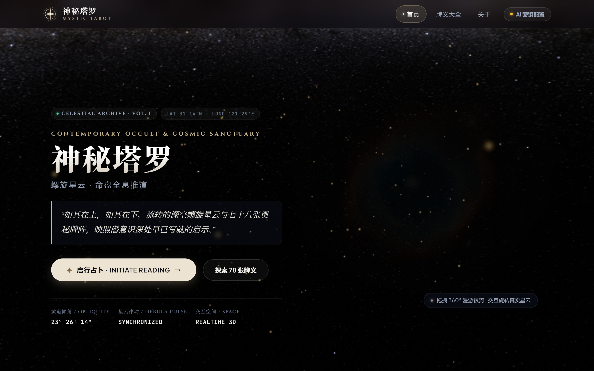
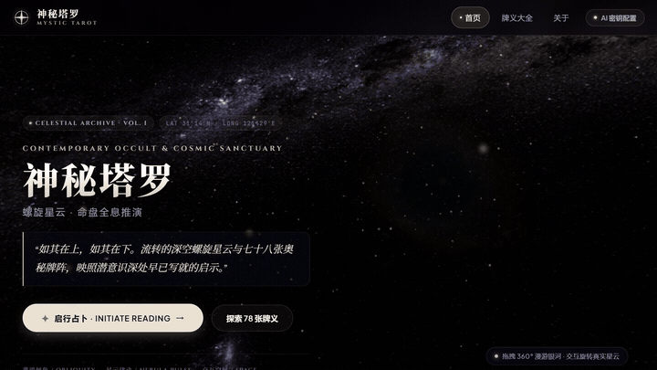
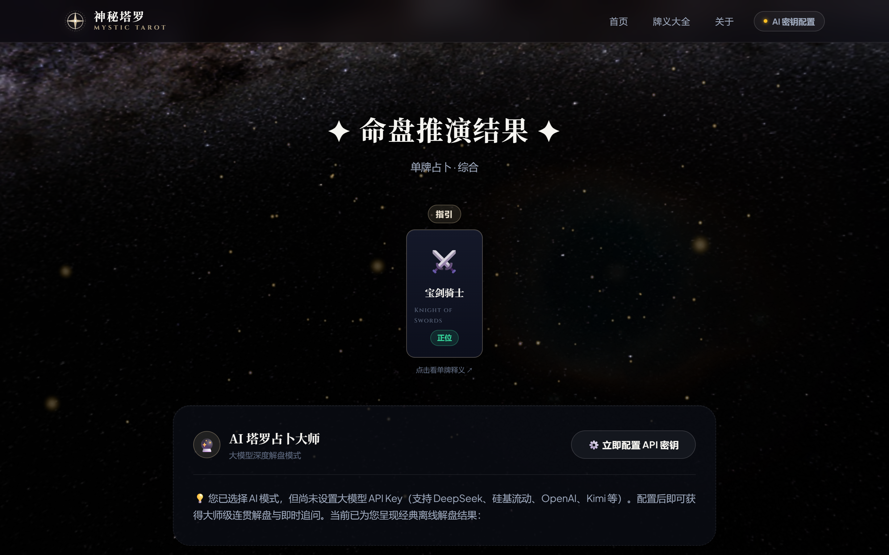
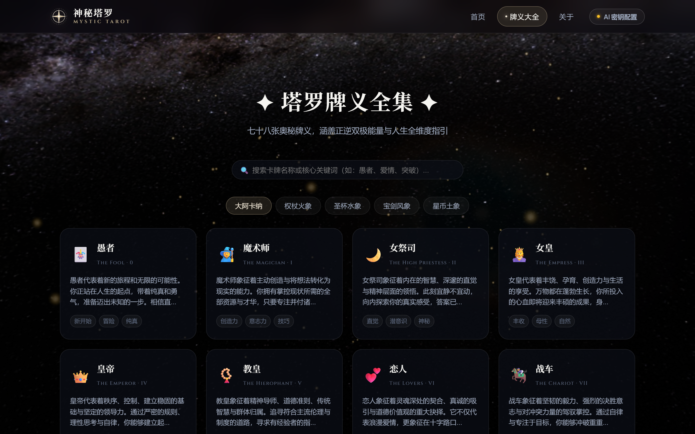
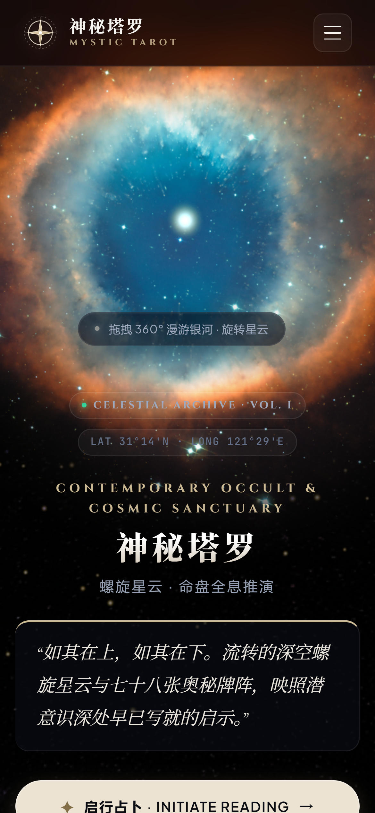
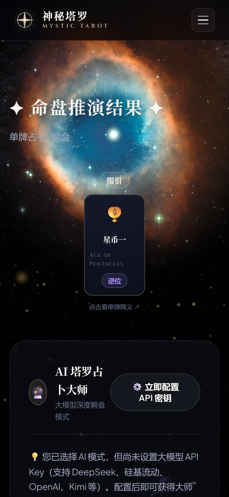

# ✦ 神秘塔罗 · Mystic Tarot

<p align="center">
  
</p>

<p align="center">
  <strong>当代神秘主义与设计美学交汇的数字占卜殿堂 · 沉浸式 3D 螺旋星云 × 78 张全量塔罗牌阵 × AI 原型导师</strong>
</p>

<p align="center">
  <a href="https://yaohaoliang141-max.github.io/mystic-tarot/"><strong>🌐 在线体验 (Live Demo)</strong></a> ·
  <a href="#-真实界面演示-live-preview"><strong>动态演示</strong></a> ·
  <a href="#-界面实机截图-showcase"><strong>界面截图</strong></a> ·
  <a href="#-快速开始"><strong>快速开始</strong></a> ·
  <a href="#english"><strong>English</strong></a>
</p>

<p align="center">
  
  
  
  
  
</p>

---

## 🎬 真实界面演示 (Live Preview)

### 🪐 实时 3D 螺旋星云与交互动效 (Realtime 3D Helix Nebula)

> 采用纯数学建模构建的螺旋星云（Helix Nebula）真实天体模型。包含碧蓝宝石核心等离子体、炽红双环膨胀气体与数万颗深空微尘，随鼠标与触控产生阻尼漫游视差。

<p align="center">
  
</p>

> 💡 **高清演示视频**：仓库 `assets/` 目录下提供完整高清 MP4 视频文件 [`assets/demo.mp4`](assets/demo.mp4)。

---

## 📸 界面实机截图 (Showcase)

### 🖥️ 桌面端沉浸式体验 (Desktop View)

<table width="100%">
  <tr>
    <td width="50%" align="center">
      
      <br />
      <strong>✦ 首页：深空星云与当代独立工作室版式</strong>
      <p><em>定制 SVG 天体之眼品牌标徽、冷黑底色与分级字体排印</em></p>
    </td>
    <td width="50%" align="center">
      
      <br />
      <strong>✦ 牌阵选择：神圣几何符号与玻璃拟态</strong>
      <p><em>单牌、时间之流、爱情相契与凯尔特十字四大经典阵法</em></p>
    </td>
  </tr>
  <tr>
    <td width="50%" align="center">
      
      <br />
      <strong>✦ 占卜结果：直观核心断语与 AI 深度解盘</strong>
      <p><em>正逆位翡翠胶囊标、明确结论判定与 AI 灵性导师多轮追问</em></p>
    </td>
    <td width="50%" align="center">
      
      <br />
      <strong>✦ 牌义全集：实时搜索与全量原型知识库</strong>
      <p><em>涵盖 22 张大阿卡纳与 56 张小阿卡纳（权杖/圣杯/宝剑/星币）</em></p>
    </td>
  </tr>
</table>

### 📱 移动端优先与触控人体工程学 (Mobile-First Experience)

> 专为手机小屏幕量身定制：首屏独立开辟 3D 漫游星云透空舞台，避免文字遮挡；弹窗采用自底向上的 iOS / shadcn 风格 **Bottom Sheet**，单手操作自然舒适。

<p align="center">
  
  
  
</p>

---

## ✨ 核心亮点

- 🪐 **纯实时 3D 真实螺旋星云 (Helix Nebula)** — 基于 Three.js 打造深邃天体模型，支持全角度阻尼鼠标与单指触控拖拽漫游。
- 🏛️ **当代独立设计工作室审美 (Contemporary Studio Aesthetic)** — 融入 `UI UX Pro Max` 与 `shadcn/ui` 规范，采用黑曜深空冷色调底色（`#030306`）、细微发丝线边框（Hairline Border）、20px 磨砂高斯模糊与克制哑金质感。
- 🔤 **专业字体排版系统 (Fontsource 规范)** — 融合古典仪式衬线体 `Cinzel`、文学引言 `Cormorant Garamond`、中文优雅宋体 `Noto Serif SC` 与等宽天文数据体 `JetBrains Mono`。
- ⚜️ **原创品牌矢量标识 (Logo Design Skill)** — 手绘纯 SVG 天体之眼（Celestial Oculus）星轨徽标与神圣几何（Sacred Geometry）卡背纹理，彻底告别粗糙 Emoji。
- 🤖 **AI 塔罗占卜师 Agent (支持主流大模型)** — 直连 DeepSeek、硅基流动 (SiliconFlow)、OpenAI、Kimi、智谱 GLM 等 API，进行千字个性化立体解盘，并支持解牌后实时无尽追问。
- 🎯 **明确断语，告别繁复点击** — 抽牌后直接在牌面下方显式呈现【核心判定与定性断语】，无需折腾多层弹窗即可获悉结论。
- 🎴 **完整 78 张全量牌义库** — 22 张大阿卡纳 + 56 张小阿卡纳全部收录，支持正逆位、爱情、事业、健康、财运等多维度深度指引与实时模糊检索。
- 🔒 **隐私至上与本地化存储** — 纯前端无第三方中转，大模型 API Key 仅保存在浏览器本地 LocalStorage，安全无忧。

---

## 🚀 快速开始

### 方式一：直接在线体验

点击直接访问：[https://yaohaoliang141-max.github.io/mystic-tarot/](https://yaohaoliang141-max.github.io/mystic-tarot/)

### 方式二：本地运行

由于项目为纯前端零构建依赖架构，直接克隆即可启动：

```bash
# 克隆仓库
git clone https://github.com/yaohaoliang141-max/mystic-tarot.git
cd mystic-tarot

# 使用 Python 启动轻量静态服务
python -m http.server 8080

# 或使用 Node.js
npx serve .
```

在浏览器中打开 `http://localhost:8080` 即可体验。

---

## 🏗️ 项目架构

```
mystic-tarot/
├── assets/                     # 真实页面实机截图、动态演示 GIF 与 MP4 视频
│   ├── hero-desktop.png        # 桌面端首页高清截图
│   ├── spreads-desktop.png     # 牌阵选择页截图
│   ├── reading-result-desktop.png # 占卜结果与 AI 追问截图
│   ├── meanings-desktop.png    # 78 张牌义大全检索截图
│   ├── mobile-hero.png         # 手机端首页视窗截图
│   ├── mobile-result.png       # 手机端结果页截图
│   ├── mobile-drawer.png       # 手机端底部抽屉弹窗截图
│   ├── preview.gif             # 3D 星云交互动态预览 GIF
│   └── demo.mp4                # 高清演示视频
├── css/
│   └── style.css               # 全局 Design Tokens、组件库、响应式与动画规范
├── js/
│   ├── tarot-data.js           # 78 张塔罗牌全量数据库及四大牌阵定义
│   ├── celestial-astrolabe.js  # Three.js 3D 真实螺旋星云与星尘着色器系统
│   └── app.js                  # 页面路由、卡牌抽取、离线判词与 AI 对话流
├── index.html                  # 语义化单页应用主体（含矢量 Logo 与排印结构）
└── README.md                   # 项目综合文档与视觉画廊
```

---

## 🛠️ 设计体系与技术栈

| 模块 | 技术 / 规范 | 实际应用 |
| :--- | :--- | :--- |
| **3D 天体引擎** | [Three.js](https://threejs.org/) | 真实螺旋星云数学粒子建模、相机视锥体动态适配、阻尼空间漫游 |
| **设计系统** | [UI UX Pro Max](https://github.com/nextlevelbuilder/ui-ux-pro-max-skill) | 全局 `:root` Design Tokens、冷色深空黑曜配色、间距与层次标尺 |
| **组件交互** | [shadcn/ui](https://github.com/shadcn-ui/ui) | 磨砂卡片、发丝线边框、分段胶囊控制器、移动端 Bottom Sheet |
| **微动效** | [React Bits](https://github.com/DavidHDev/react-bits) & [Magic UI](https://github.com/magicuidesign/magicui) | 光束扫掠（Subtle Glow）、卡片 3D 透视倾斜（Perspective Tilt）、平滑翻牌 |
| **字体栈** | [Fontsource](https://github.com/fontsource/fontsource) | Cinzel / Cormorant Garamond / Noto Serif SC / JetBrains Mono |
| **品牌识别** | [Logo Design Skill](https://github.com/kaankiziltug/logo-design-skill) | 原创矢量天体之眼（Celestial Oculus）星轨徽标与神圣几何纹理 |
| **AI 原型引擎** | OpenAI API Compatible | 直连 DeepSeek / SiliconFlow / OpenAI / Kimi / GLM 原生流式对话 |

---

## 🎯 占卜使用流程

1. **选择阵法**：根据心境选择「单牌启示」、「时间之流」、「爱情相契」或「凯尔特十字」；
2. **冥想困惑**：输入心中困惑问题并选取所属领域（综合、情感、事业、身心、财富）；
3. **直觉抽牌**：在沉浸式牌堆中感召命运卡牌，触发 3D 翻转仪式；
4. **即时答复**：牌面下方即刻显示明确核心结论，无需折叠弹窗；
5. **AI 导师追问**：配置 API 密钥后，可与 AI 灵性导师针对牌面进行深度多轮对话与行动建议。

---

## 📄 开源许可

本项目遵循 [MIT License](LICENSE) 开源协议。

---

## English

### ✨ Overview

**Mystic Tarot** is a modern, luxury web application blending contemporary design studio aesthetics, real-time 3D cosmic visuals (Three.js Helix Nebula), authentic 78-card Tarot readings, and conversational AI spiritual mentorship.

### 🌟 Key Features
- **Realtime 3D Nebula**: Procedural Helix Nebula with glowing emerald core, expanding ionized red gases, and interactive camera panning.
- **Mobile-First UX**: Dedicated top aperture for 3D navigation on phones, ergonomic Bottom Sheet drawers for card details.
- **Definitive Readings**: Immediate verdict and clear guidance presented directly beneath each card.
- **AI Archetype Agent**: Supports streaming consultations and multi-turn follow-up inquiries via DeepSeek, SiliconFlow, OpenAI, Kimi, and GLM endpoints.
- **Full 78-Card Deck**: 22 Major Arcana + 56 Minor Arcana with multi-domain interpretations (Love, Career, Health, Wealth).
